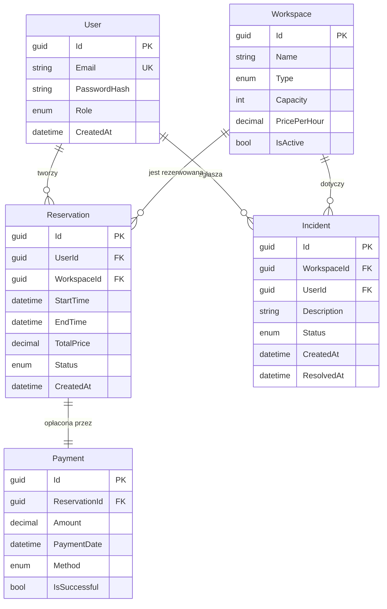

# FlexDesk — System Zarządzania Przestrzenią Co-workingową


FlexDesk to pełna aplikacja webowa (backend REST API + frontend + baza danych) do zarządzania przestrzenią biura co-workingowego: rezerwacji biurek, sal konferencyjnych i prywatnych gabinetów wraz z płatnościami i zgłaszaniem usterek.

---

## Spis treści

- [Opis projektu](#opis-projektu)
- [Technologie](#technologie)
- [Architektura](#architektura)
- [Model danych (ERD)](#model-danych-erd)
- [Uruchomienie](#uruchomienie)
- [Konta demo](#konta-demo)
- [Główne funkcjonalności](#główne-funkcjonalności)
- [Reguły biznesowe](#reguły-biznesowe)
- [Dokumentacja REST API](#dokumentacja-rest-api)
- [Testy](#testy)
- [Zmienne środowiskowe](#zmienne-środowiskowe)
- [Struktura projektu](#struktura-projektu)

---

## Opis projektu

Biura co-workingowe potrzebują systemu do zarządzania dostępnością przestrzeni, a użytkownicy chcą łatwo je rezerwować i opłacać. FlexDesk rozwiązuje ten problem:

- użytkownik przegląda i filtruje dostępne przestrzenie, rezerwuje je na wybrany przedział czasu, opłaca rezerwację i zgłasza usterki,
- administrator zarządza katalogiem przestrzeni, widzi wszystkie rezerwacje i obsługuje zgłoszenia usterek,
- po opłaceniu rezerwacji system **asynchronicznie** wysyła e-mail z potwierdzeniem (RabbitMQ + usługa w tle).

---

## Technologie

| Warstwa | Technologia |
|---|---|
| Backend | ASP.NET Core 10 (C#), REST API |
| ORM / migracje | Entity Framework Core + Npgsql |
| Baza danych | PostgreSQL 17 |
| Uwierzytelnianie | JWT (JSON Web Tokens), hasła hashowane BCrypt |
| Walidacja | FluentValidation |
| Asynchroniczność | RabbitMQ + .NET Hosted Service (konsument) |
| E-mail | SMTP (MailHog w dev) |
| Frontend | React 18 + TypeScript (Vite), React Router |
| Testy | xUnit, Testcontainers (PostgreSQL) |
| Konteneryzacja | Docker, Docker Compose |
| CI | GitHub Actions |

---

## Architektura

Backend ma klasyczny podział na warstwy (clean architecture):

```
FlexDesk.Api            Kontrolery, middleware, uwierzytelnianie, Swagger
FlexDesk.Application    Logika biznesowa (serwisy), DTO, walidatory, interfejsy
FlexDesk.Domain         Encje i enumy (czysty model, bez zależności)
FlexDesk.Infrastructure EF Core, repozytoria, RabbitMQ, e-mail, bezpieczeństwo
FlexDesk.Tests          Testy jednostkowe i integracyjne
```

Przepływ żądania: **Controller → Service (reguły biznesowe) → DbContext → PostgreSQL**.
Logika biznesowa jest oddzielona od obsługi HTTP; API zwraca błędy w formacie **ProblemDetails (RFC 9110)**.

---

## Model danych (ERD)



---

## Uruchomienie

### Wymagania

- [Docker](https://www.docker.com/) + Docker Compose (zalecany sposób),
- do uruchomienia lokalnego bez Dockera: .NET SDK 10, Node.js 22, działający PostgreSQL.

### Szybki start (Docker Compose) — zalecane

```bash
# 1. Skopiuj szablon zmiennych środowiskowych i uzupełnij sekrety
cp .env.example .env
#    W pliku .env ustaw m.in. silny Jwt__Secret oraz hasła (POSTGRES_PASSWORD, RABBITMQ_PASSWORD).
#    Przykład generowania sekretu:  openssl rand -base64 48

# 2. Zbuduj i uruchom cały system jedną komendą
docker compose up -d --build
```

Po chwili dostępne są:

| Usługa | Adres |
|---|---|
| Frontend (aplikacja) | http://localhost:8080 |
| Backend (REST API) | http://localhost:5080 |
| MailHog (podgląd e-maili) | http://localhost:8025 |
| RabbitMQ (panel) | http://localhost:15672 |

Backend na starcie automatycznie migruje schemat bazy i zakłada konta demo oraz przykładowe przestrzenie.

Zatrzymanie: `docker compose down` (dodaj `-v`, aby usunąć także dane bazy).

### Uruchomienie lokalne (tryb deweloperski)

```bash
# Infrastruktura w kontenerach
docker compose up -d db rabbitmq mailhog

# Backend — wymaga pliku src/FlexDesk.Api/appsettings.Development.json
#   z connection stringiem i sekretem JWT (patrz: Zmienne środowiskowe)
dotnet run --project src/FlexDesk.Api        # API na http://localhost:5249

# Frontend
cd frontend
npm install
npm run dev                                   # aplikacja na http://localhost:5173
```

---

## Konta demo

Zakładane automatycznie przy pierwszym uruchomieniu:

| Rola | E-mail | Hasło |
|---|---|---|
| Administrator | `admin@flexdesk.local` | `Admin123!` |
| Użytkownik | `user@flexdesk.local` | `User123!` |

---

## Główne funkcjonalności

### Role

- **USER** — przegląda i filtruje przestrzenie, rezerwuje, opłaca (symulacja), anuluje swoje rezerwacje, zgłasza usterki; widzi tylko swoje dane.
- **ADMIN** — zarządza katalogiem przestrzeni (CRUD), widzi wszystkie rezerwacje, prowadzi workflow zgłoszeń usterek.

### Przepływ rezerwacji

`Pending` (utworzona) → `Confirmed` (po opłaceniu) → opcjonalnie `Cancelled` (anulowana).
Po potwierdzeniu system publikuje zdarzenie do RabbitMQ, a usługa w tle wysyła e-mail z potwierdzeniem.

---

## Reguły biznesowe

Zaimplementowane w warstwie serwisów (poza kontrolerami):

1. **Brak konfliktu terminów** — nie można zarezerwować przestrzeni, jeśli w wybranym przedziale istnieje już aktywna rezerwacja (`Pending`/`Confirmed`). Dodatkowo chronione **optimistic lockingiem** (kolumna `xmin`) przed podwójną rezerwacją.
2. **Zasady anulowania (24h)** — zwykły użytkownik może anulować rezerwację tylko gdy do startu pozostało > 24h (admin bez ograniczeń).
3. **Minimalny czas wg typu** — HotDesk ≥ 1h, MeetingRoom ≥ 2h, Office ≥ 4h.
4. **Dynamiczna wycena** — cena = liczba godzin × stawka; dla rezerwacji ≥ 8h rabat 10%. Cenę liczy serwer.

Dodatkowo: zgłoszenie usterki ma stan terminalny (`Resolved` nie da się zmienić), a przestrzeni z rezerwacjami nie można usunąć.

---

## Dokumentacja REST API

### Swagger / OpenAPI

W trybie deweloperskim interaktywna dokumentacja jest dostępna pod **http://localhost:5249/swagger** (przycisk „Authorize" pozwala wkleić token JWT).

### Endpointy

| Metoda | Ścieżka | Dostęp | Opis |
|---|---|---|---|
| POST | `/api/auth/register` | publiczny | Rejestracja (zwraca token) |
| POST | `/api/auth/login` | publiczny | Logowanie (zwraca token) |
| GET | `/api/workspaces` | publiczny | Lista przestrzeni (paginacja + filtry) |
| GET | `/api/workspaces/{id}` | publiczny | Szczegóły przestrzeni |
| POST | `/api/workspaces` | ADMIN | Utworzenie przestrzeni |
| PUT | `/api/workspaces/{id}` | ADMIN | Edycja przestrzeni |
| DELETE | `/api/workspaces/{id}` | ADMIN | Usunięcie przestrzeni |
| GET | `/api/reservations` | zalogowany | Rezerwacje (swoje / wszystkie dla admina) |
| GET | `/api/reservations/{id}` | właściciel/ADMIN | Szczegóły rezerwacji |
| POST | `/api/reservations` | zalogowany | Utworzenie rezerwacji |
| POST | `/api/reservations/{id}/pay` | właściciel/ADMIN | Opłacenie rezerwacji |
| POST | `/api/reservations/{id}/cancel` | właściciel/ADMIN | Anulowanie rezerwacji |
| GET | `/api/incidents` | zalogowany | Zgłoszenia (swoje / wszystkie dla admina) |
| GET | `/api/incidents/{id}` | właściciel/ADMIN | Szczegóły zgłoszenia |
| POST | `/api/incidents` | zalogowany | Zgłoszenie usterki |
| PUT | `/api/incidents/{id}/status` | ADMIN | Zmiana statusu zgłoszenia |

Parametry listy przestrzeni: `?page=&pageSize=&type=&minCapacity=&isActive=&search=`.

---

## Testy

```bash
dotnet test
```

- **Testy jednostkowe** — reguły biznesowe (wycena, minimalny czas, zasady anulowania) bez bazy.
- **Testy integracyjne** — pełne REST API na realnym PostgreSQL uruchamianym przez Testcontainers (wymaga działającego Dockera).

---

## Zmienne środowiskowe

Wszystkie wartości wrażliwe trzymane są poza repozytorium. Szablon: [`.env.example`](.env.example).

Najważniejsze klucze (`.env` — dla Docker Compose):

| Zmienna | Opis |
|---|---|
| `POSTGRES_USER` / `POSTGRES_PASSWORD` / `POSTGRES_DB` | Baza danych |
| `Jwt__Secret` | Sekret do podpisywania tokenów (długi, losowy) |
| `RABBITMQ_USER` / `RABBITMQ_PASSWORD` | Broker wiadomości |
| `FRONTEND_PORT` / `BACKEND_PORT` | Porty publikowane na hoście |

Dla uruchomienia lokalnego (bez Dockera) utwórz `src/FlexDesk.Api/appsettings.Development.json`:

```json
{
  "ConnectionStrings": {
    "Default": "Host=localhost;Port=5432;Database=flexdesk;Username=flexdesk;Password=TWOJE_HASLO"
  },
  "Jwt": { "Secret": "DLUGI_LOSOWY_SEKRET_MIN_32_ZNAKI" },
  "RabbitMq": { "Password": "TWOJE_HASLO_RABBITMQ" }
}
```

---

## Struktura projektu

```
flexdesk/
├── src/
│   ├── FlexDesk.Api/            # REST API, kontrolery, Program.cs, Dockerfile
│   ├── FlexDesk.Application/    # logika biznesowa, DTO, walidatory
│   ├── FlexDesk.Domain/         # encje i enumy
│   └── FlexDesk.Infrastructure/ # EF Core, RabbitMQ, e-mail, bezpieczeństwo
├── tests/
│   └── FlexDesk.Tests/          # testy jednostkowe i integracyjne
├── frontend/                    # aplikacja React + TypeScript (Vite, nginx)
├── docker-compose.yml           # db, rabbitmq, mailhog, backend, frontend
├── .github/workflows/ci.yml     # CI (build + testy)
└── .env.example                 # szablon konfiguracji
```
